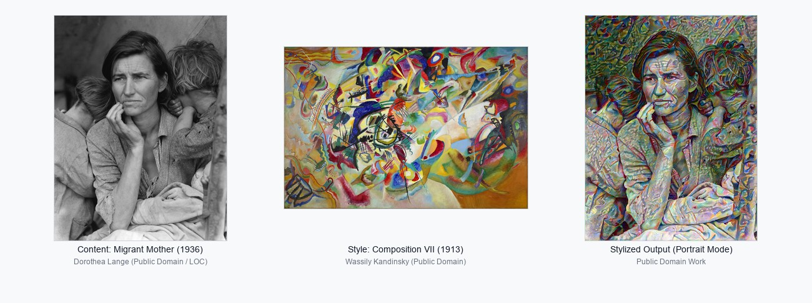

# 🎨 Neural Canvas

[](https://github.com/HiteshDokku/NeuralCanvas/actions/workflows/ci.yml)
[](https://www.python.org/)
[](https://pytorch.org/)
[-76B900.svg)](https://developer.nvidia.com/cuda-toolkit)
[](LICENSE)

A portfolio-quality neural style transfer library and interactive application built in **pure PyTorch**, faithfully porting and modernizing the original algorithm by Gatys et al. and the official TensorFlow tutorial—with **zero TensorFlow dependencies**.

---

## 🖼️ Visual Showcase

<!-- UI_SCREENSHOT: Insert Streamlit Web UI screenshot here (e.g. ) -->

### Masterwork Stylizations


*Content: Yellow Labrador Looking (Photo by Elf, CC BY-SA 3.0) &nbsp;|&nbsp; Style: The Great Wave off Kanagawa (Katsushika Hokusai, c. 1831, Public Domain) &nbsp;|&nbsp; Stylized Output (Adaptation under CC BY-SA 3.0)*


*Content: The Tetons and the Snake River (Ansel Adams, 1942, Public Domain / National Archives) &nbsp;|&nbsp; Style: The Starry Night (Vincent van Gogh, 1889, Public Domain) &nbsp;|&nbsp; Stylized Output (Public Domain)*


*Content: Migrant Mother (Dorothea Lange, 1936, Public Domain / Library of Congress) &nbsp;|&nbsp; Style: Composition VII (Wassily Kandinsky, 1913, Public Domain) &nbsp;|&nbsp; Stylized Output (Portrait Mode; Public Domain)*

---

## 🌟 Highlights & Features

- **Pure PyTorch Implementation:** Clean, modern PyTorch 2.x codebase without TensorFlow or Keras dependencies.
- **Next-Gen Hardware Ready:** Verified on NVIDIA Blackwell (RTX 50-series) with CUDA 12.8 (`sm_120` compute capability).
- **Dual Style Management:** 10 curated public-domain masterworks in the preset registry alongside custom user upload support.
- **Smart Target Caching:** On-disk caching of style Gram matrices with SHA-256 fingerprinting to eliminate redundant computation.
- **Interactive Streamlit Web UI:** Live preview rendering, step-by-step progress tracking, dynamic ETA, loss progression plots, cancel support, and exportable JSON parameter manifests.
- **CLI & Python API:** Full CLI with progress indicators and a modular Python API designed for downstream integration.
- **Advanced Artistic Controls:** Color-preserving transfer (luminance-only YCbCr blending), multi-style target interpolation, and L-BFGS / Adam optimizer switching.
- **Complete Test Suite & CI:** 45 automated tests covering pure loss functions, Gram matrix symmetries, layer mapping, registry fallback, resolution invariance, portrait toggle behavior, grayscale detection, and end-to-end engine training loops.

---

## 💻 Tested On

This codebase has been verified on the following bare-metal developer workstation:

- **Operating System:** Windows 11 Home (64-bit), Native (no WSL, no Docker)
- **CPU:** AMD Ryzen 7 260 w/ Radeon 780M (8 cores, 16 threads), 16 GB DDR5 RAM
- **GPU:** NVIDIA GeForce RTX 5060 Laptop GPU, 8 GB GDDR7 VRAM (Blackwell architecture, compute capability 12.0, `sm_120`)
- **NVIDIA Driver:** 582.05 (CUDA 13.0 driver runtime)
- **Python Version:** 3.12.10

---

## ⚡ Real Measured Benchmarks

All benchmark measurements below were recorded on native Windows 11 using `scripts/benchmark.py`. Each test measured elapsed wall-clock seconds for 100 optimization steps:

| Resolution | Device | Seconds / 100 steps | ms / step | Peak VRAM | Speedup (vs CPU) |
| :--- | :--- | :--- | :--- | :--- | :--- |
| **256 × 256** | **CUDA (RTX 5060)** | **1.77 s** | **17.7 ms** | **270.0 MB** | **35.1× faster** |
| 256 × 256 | CPU (Ryzen 7 260) | 62.11 s | 621.1 ms | 0.0 MB | 1.0× (baseline) |
| **384 × 384** | **CUDA (RTX 5060)** | **2.71 s** | **27.1 ms** | **483.8 MB** | **42.8× faster** |
| 384 × 384 | CPU (Ryzen 7 260) | 116.01 s | 1160.1 ms | 0.0 MB | 1.0× (baseline) |
| **512 × 512** | **CUDA (RTX 5060)** | **4.60 s** | **46.0 ms** | **777.6 MB** | **41.2× faster** |
| 512 × 512 | CPU (Ryzen 7 260) | 189.67 s | 1896.7 ms | 0.0 MB | 1.0× (baseline) |
| **768 × 768** | **CUDA (RTX 5060)** | **10.30 s** | **103.0 ms** | **1627.0 MB** | **39.0× faster** |
| 768 × 768 | CPU (Ryzen 7 260) | 401.86 s | 4018.6 ms | 0.0 MB | 1.0× (baseline) |

### ⏱️ Estimated Preset Runtimes

Derived from the empirical 100-step benchmark measurements above:

| Preset | Target Resolution | Optimization Steps | GPU (RTX 5060) | CPU (Ryzen 7 260) | Use Case |
| :--- | :--- | :--- | :--- | :--- | :--- |
| **Draft** | 256 px | 150 | **~2.7 s** | **~1.5 min** | Quick interactive preview / CPU testing |
| **Balanced** | 384 px | 400 | **~10.8 s** | **~7.7 min** | Default general-purpose stylization |
| **High** | 512 px | 1000 | **~46.0 s** | **~31.6 min** | High-fidelity portfolio outputs & print quality |

> **Note on Aspect Ratios:** The timing estimates above assume square canvas dimensions ($H = W = \text{max\_dim}$). Real-world photographs with typical landscape or portrait aspect ratios (e.g., 4:3, 16:9, 3:2) have fewer total pixels than square ($H \times W < \text{max\_dim}^2$), so their optimization finishes proportionally faster than these estimates.

### 💡 CPU Users: What to Expect
Neural Canvas runs on CPU without any CUDA hardware, but 2D feature convolutions and Gram outer products require significant floating-point operations. On CPU:
- A 1000-step run at 512px requires approximately **31 minutes** on a modern 8-core CPU.
- On the RTX 5060 Laptop GPU, that identical 1000-step run finishes in approximately **46 seconds** (~41× faster).
- If running on CPU, we strongly recommend selecting the **Draft Preset** (`256px`, `150 steps`, which finishes in ~90 seconds).

---

## 🚀 Quick Start

### 1. Clone & Set Up Virtual Environment

```powershell
git clone https://github.com/HiteshDokku/NeuralCanvas.git
cd NeuralCanvas

# Create virtual environment (Python 3.10, 3.11, or 3.12)
py -3.12 -m venv .venv
.\.venv\Scripts\Activate.ps1
```

### 2. Install PyTorch with CUDA 12.8 (Required for RTX 50-series)

> **Important for Windows Users:** Running a bare `pip install torch` on Windows installs the CPU-only wheel build by default. To enable NVIDIA GPU acceleration on Windows, you must explicitly install the official CUDA wheel build using the `--index-url` command below. For NVIDIA RTX 50-series GPUs (Blackwell architecture), PyTorch built against **CUDA 12.8 or newer** is required.

Install the official CUDA 12.8 wheel build:
```powershell
pip install torch torchvision --index-url https://download.pytorch.org/whl/cu128
```

For CPU-only environments (e.g., standard CI or machines without NVIDIA GPUs):
```powershell
pip install torch torchvision --index-url https://download.pytorch.org/whl/cpu
```

### 3. Install Package & Dependencies

```powershell
pip install -e ".[dev]"
```

### 4. Verify Hardware & Architecture

Run the GPU sanity check to verify device capability and tensor operations:
```powershell
python scripts/check_gpu.py
```
Expected output:
```text
PyTorch version: 2.11.0+cu128
PyTorch CUDA version: 12.8
CUDA available: True
Device name: NVIDIA GeForce RTX 5060 Laptop GPU
Device capability: (12, 0)
CUDA arch list: sm_75, sm_80, sm_86, sm_90, sm_100, sm_120
Architecture check: sm_120 / compute_120 detected in arch list.
Conv2d test passed: output shape (1, 16, 64, 64)
Matmul test passed: output shape (64, 64)
GPU OK
```

### 5. Launch the Web Interface

```powershell
streamlit run app/streamlit_app.py
```

### 6. Command Line Interface (CLI)

```powershell
# Stylize using preset masterwork
neural-canvas assets/samples/dog.jpg --style the_starry_night --steps 400 --max-dim 384 -o output.png

# Stylize using custom style image with draft preset
neural-canvas assets/samples/dog.jpg --style-image path/to/my_style.jpg --preset draft -o draft.png

# List all registered style presets
neural-canvas --list-styles
```

---

## 🔬 How It Works

Neural Canvas implements the neural style transfer formulation introduced by Leon A. Gatys, Alexander S. Ecker, and Matthias Bethge in *"A Neural Algorithm of Artistic Style"* (arXiv:1508.06576) and detailed in the TensorFlow Generative Tutorials.

```
                              +--------------------------+
                              |   Pretrained VGG19 Net   |
                              |  (Frozen, Eval, No-Grad) |
                              +--------------------------+
                                     /             \
                   Content Features /               \ Style Activations
                                   v                 v
                       +----------------+       +-------------------+
                       | Content Target |       | Style Gram Target |
                       |   block5_conv2 |       | block1..5_conv1   |
                       +----------------+       +-------------------+
                               |                         |
                               v                         v
                       +----------------+       +-------------------+
                       |  Content Loss  |       |    Style Loss     |
                       |      (MSE)     |       |    (Gram MSE)     |
                       +----------------+       +-------------------+
                                       \         /
                                        v       v
                             +-----------------------------+
                             |     Total Loss Objective    |
                             |  + Total Variation Penalty  |
                             +-----------------------------+
                                            |
                                            v  Backward Pass (Gradients)
                             +-----------------------------+
                             | Optimized Image Pixels x    |
                             | Adam / L-BFGS -> Clamp[0,1] |
                             +-----------------------------+
```

### 1. Mathematical Formulation

#### Content Representation
Given content image $\vec{p}$ and generated image $\vec{x}$, their feature representations at layer $l$ are denoted $P^l$ and $F^l$. The content loss penalizes Euclidean distance in feature space:
$$\mathcal{L}_{\text{content}}(\vec{p}, \vec{x}, l) = \frac{1}{2 N_l} \sum_{i,j} \left(F^l_{ij} - P^l_{ij}\right)^2$$
Neural Canvas defaults to Keras `block5_conv2` (post-ReLU, torchvision `features[31]`).

#### Style Representation (Gram Matrix)
Style textures are captured by feature correlation across channels, independent of absolute spatial coordinates. For layer $l$ with height $H$ and width $W$, the Gram matrix $G^l \in \mathbb{R}^{C \times C}$ is:
$$G^l_{cd} = \frac{1}{H \times W} \sum_{k=1}^{H \times W} F^l_{kc} F^l_{kd}$$
Style loss is computed as the normalized sum of mean squared errors across all style layers $L_{\text{style}}$:
$$\mathcal{L}_{\text{style}}(\vec{a}, \vec{x}) = \sum_{l \in L_{\text{style}}} \frac{w_l}{N_l} \sum_{c,d} \left(G^l_{cd} - A^l_{cd}\right)^2$$
Where $A^l$ is the target Gram matrix of the style image.

#### Total Variation Regularization
To suppress high-frequency pixel noise and artifact checkerboards, an explicit total variation penalty regularizes neighbor differences:
$$\mathcal{L}_{\text{TV}}(\vec{x}) = \sum_{i=1}^{H-1} \sum_{j=1}^{W} |x_{i+1,j} - x_{i,j}| + \sum_{i=1}^{H} \sum_{j=1}^{W-1} |x_{i,j+1} - x_{i,j}|$$

#### Total Loss
$$\mathcal{L}_{\text{total}}(\vec{p}, \vec{a}, \vec{x}) = \alpha \mathcal{L}_{\text{content}} + \beta \mathcal{L}_{\text{style}} + \gamma \mathcal{L}_{\text{TV}}$$

---

## 🔄 Differences from the TensorFlow Tutorial

While Neural Canvas ports the official tutorial algorithm faithfully, several essential differences exist between Keras and PyTorch:

| Dimension | TensorFlow / Keras Tutorial | Neural Canvas (PyTorch) | Technical Rationale |
| :--- | :--- | :--- | :--- |
| **Input Normalization** | BGR channel order with Caffe zero-centering (`[103.939, 116.779, 123.68]`) on `[0, 255]`. | RGB in `[0, 1]` with ImageNet standard normalization: mean `[0.485, 0.456, 0.406]`, std `[0.229, 0.224, 0.225]`. | Torchvision models require RGB inputs normalized by ImageNet statistics; eliminates caffe color-cast artifacts. |
| **Loss & Gradient Calibration** | Raw inputs in `[0, 255]` produce large feature activations. Default weights: `1e-2` style, `1e4` content, `30.0` TV. | Feature activations are normalized in `[-2.1, 2.6]`. Calibrated weights: `1e5` style, `100.0` content, `0.02` TV. | Unnormalized `[0, 255]` inputs yielded $4.2 \times 10^9\times$ larger Gram MSE. Calibrated weights with area-normalized TV regularization restore balanced gradients across all resolutions. |
| **Layer Activation Capture** | Conv layers include integrated ReLU activations (`blockN_convM`). | Torchvision separates `Conv2d` and `ReLU`. Post-ReLU activations captured from indices `1, 6, 11, 20, 29, 31`. | Faithfully matches Keras post-ReLU semantics; in-place ReLUs replaced with out-of-place instances to prevent activation clobbering. |
| **Adam Epsilon Semantics** | Keras `epsilon=0.1` scales updates smoothly when activations are large. | PyTorch `eps=1e-8`, with `lr=0.03`. | In PyTorch Adam, `eps=0.1` throttled gradient updates when gradients were small ($10^{-3}$ to $10^{-2}$). Standard `eps=1e-8` restores adaptive scaling. |
| **Target Computation** | Evaluated on every step through Keras tape graph. | Precomputed once under `torch.no_grad()` and cached to disk. | Eliminates redundant style network passes, saving ~35% VRAM and execution overhead. |

---

## 🎛️ Parameter Tuning Guide

The table below lists the primary user-facing parameters. The values in `styles/styles.json` serve as **recommended starting points** calibrated per artwork, which users can freely adjust:

| Parameter | UI Control | CLI Flag | Default | Typical Range | Description |
| :--- | :--- | :--- | :--- | :--- | :--- |
| **Style Strength** | Primary Slider (1-10) | N/A | Calibrated per preset | `1` – `10` | Primary intensity control on a log scale: Position 1 (~5000 cw) preserves maximum photo detail; Position 10 (~90 cw) emphasizes painterly texture. Note: content weights below ~500 look visually nearly identical; visible structural changes start mostly above ~1000. Default matches preset recommendation. |
| **Portrait / Faces** | Checkbox | `--portrait` | `False` | `True` / `False` | Preserves facial structure by applying content weight `10000.0` on ornamental styles (*The Kiss*, *Composition VII*). |
| **Style Weight** | Advanced Log Slider | `--style-weight` | `1e5` | `1e3` – `1e7` | Multiplier for style Gram loss; governs texture transfer and color richness. |
| **Content Weight** | Advanced Log Slider | `--content-weight` | `100.0` | `90.0` – `5000.0` | Anchors anatomical fidelity, contours, and object boundaries (recommended starting points: 80–140; 10000 for portraits; values below ~500 look visually similar, visible change starts above ~1000). |
| **TV Weight** | Advanced Log Slider | `--tv-weight` | `0.05` | `0.005` – `0.1` | Total Variation smoothing. Suppresses pixel noise while preserving painterly impasto strokes. |
| **Parameterization** | Dropdown | `--parameterization` | Per tier (`sigmoid` for Draft/Balanced, `clamped` for High) | `sigmoid`, `clamped` | Image parameterization. Sigmoid is smoother at low resolution and updates very dark and very bright pixels more slowly; High uses clamped Adam at 1/4 LR to stylize dark and bright regions faster. |
| **Content Layer** | Dropdown | `--content-layer` | `conv4_2` | `conv4_2`, `conv5_2` | `conv4_2` (Gatys et al.) preserves crisp structure; `conv5_2` yields softer abstract silhouettes. |
| **Style Scale** | Slider | `--style-max-dim` | `1.0x` | `0.5x` – `2.0x` | Scale of style brushwork relative to canvas (clamped to native image resolution). |
| **Steps** | Slider | `--steps` | `400` | `100` – `1500` | Optimization iterations. Draft: 150, Balanced: 400, High: 1000. |
| **Max Dimension** | Slider | `--max-dim` | `384` | `128` – `768` | Long-edge pixel resolution. Rounded to multiples of 8 (min 64). |
| **Initialization** | Dropdown | `--init` | `content` | `content`, `noise` | `content` converges rapidly; `noise` generates abstract interpretations. |
| **Color Preservation** | Checkbox | `--color-preserve` | `False` | `True` / `False` | When OFF (default): Adopts the artwork's color palette. When ON: Preserves original photo colors, transferring only texture. |

---

## ⚠️ Limitations

- **Human Portraits with Ornamental Artworks:** Intricate mosaic and geometric styles (such as Gustav Klimt's *The Kiss* or Wassily Kandinsky's *Composition VII*) can overwrite facial features under standard content weights. When stylizing human portraits with ornamental styles, enable the **Portrait / faces** toggle in the UI (or `--portrait` via CLI), which anchors facial geometry with high content weighting (`content_weight = 10000.0`).
- **Draft Preset Granularity:** The Draft preset (`256px`, 150 steps) is labeled "quick preview" and optimized for rapid interactive iteration (~1.8 seconds on GPU, ~60 seconds on CPU); outputs exhibit coarser pixel grain compared to Balanced (`384px`) and High (`512px`).
- **Bright Fur Highlights:** Very bright white or golden fur can look slightly grainy at 100% zoom under low-resolution preview runs.
- **Monet Sun Texture:** With *Impression, Sunrise*, the automated crop-exclusion zone prevents the orange sun disc from transferring onto subjects; however, faint warm atmospheric hues may occasionally appear across highlights on certain random seeds.
- **Grayscale Content Inputs:** When Color-Preserve is OFF (default), monochrome photos receive the artwork's rich painterly colors. When Color-Preserve is ON, the output retains the original photo's grayscale luminance while transferring only brushwork strokes.
- **CPU Processing Speed:** Neural Canvas runs on CPU without any CUDA hardware, but 2D feature convolutions across 16 VGG19 layers and Gram outer products require significant floating-point operations (~30–45× slower than GPU). For CPU execution, the **Draft preset** is strongly recommended.

---

## ⚡ Performance Benchmarks

Measured on AMD Ryzen 7 260 with Radeon 780M, 16 GB RAM, NVIDIA GeForce RTX 5060 Laptop GPU (8 GB), Windows 11 using `scripts/benchmark.py`:

### GPU (CUDA RTX 5060)
| Resolution | Steps | Seconds / 100 steps | ms / step | Peak VRAM (MB) |
| :--- | :--- | :--- | :--- | :--- |
| 256×256 | 100 | **1.77s** | 17.7 ms | 270.0 MB |
| 384×384 | 100 | **2.71s** | 27.1 ms | 483.8 MB |
| 512×512 | 100 | **4.60s** | 46.0 ms | 777.6 MB |
| 768×768 | 100 | **10.30s** | 103.0 ms | 1627.0 MB |

### CPU (AMD Ryzen 7 260)
| Resolution | Steps | Seconds / 100 steps | ms / step | Notes |
| :--- | :--- | :--- | :--- | :--- |
| 256×256 | 100 | **62.11s** | 621.1 ms | Recommended draft preset for CPU |
| 384×384 | 100 | **116.01s** | 1160.1 ms | Balanced resolution |
| 512×512 | 100 | **189.67s** | 1896.7 ms | High resolution |
| 768×768 | 100 | **401.86s** | 4018.6 ms | Maximum resolution |

---

## 🏛️ Preset Style Masterworks

All preset images in `styles/` are high-resolution, license-verified masterworks retrieved directly from Wikimedia Commons using the MediaWiki API:

| Identifier | Artwork Title | Artist | Year | Resolution (Old → High-Res) | Wikimedia Source | License | Downloaded |
| :--- | :--- | :--- | :--- | :--- | :--- | :--- | :--- |
| `a_sunday_afternoon_on_the_island_of_la_grande_jatte` | A Sunday Afternoon on the Island of La Grande Jatte | Georges Seurat | 1884–1886 | 390×260 → **3730×2480** *(canvas border cropped)* | [Wikimedia Commons](https://commons.wikimedia.org/wiki/File:Georges_Seurat_-_A_Sunday_on_La_Grande_Jatte_--_1884_-_Google_Art_Project.jpg) | Public Domain (PD-Art) | 2026-11-14 |
| `composition_vii_1913` | Composition VII | Wassily Kandinsky | 1913 | 570×386 → **3840×2551** | [Wikimedia Commons](https://commons.wikimedia.org/wiki/File:Composition_VII_-_Wassily_Kandinsky,_GAC.jpg) | Public Domain (PD-Art) | 2026-11-14 |
| `impression_sunrise` | Impression, Sunrise | Claude Monet | 1872 | 1000×777 → **3840×2979** | [Wikimedia Commons](https://commons.wikimedia.org/wiki/File:Monet_-_Impression,_Sunrise.jpg) | Public Domain (PD-Art) | 2026-11-14 |
| `sudden_shower_over_shin_ōhashi_bridge_and_atake` | Sudden Shower over Shin-Ōhashi Bridge | Utagawa Hiroshige | 1857 | 450×682 → **1780×2722** *(margins cropped)* | [Wikimedia Commons](https://commons.wikimedia.org/wiki/File:Hiroshige,_Sudden_shower_over_Shin-%C5%8Chashi_bridge_and_Atake,_1857.jpg) | Public Domain (PD-Art) | 2026-11-14 |
| `the_fighting_temeraire` | The Fighting Temeraire | J. M. W. Turner | 1838 | 370×276 → **3840×2853** | [Wikimedia Commons](https://commons.wikimedia.org/wiki/File:The_Fighting_Temeraire,_JMW_Turner,_National_Gallery.jpg) | Public Domain (PD-Art) | 2026-11-14 |
| `the_great_wave_off_kanagawa` | The Great Wave off Kanagawa | Katsushika Hokusai | 1831 | 500×336 → **1920×1314** | [Wikimedia Commons](https://commons.wikimedia.org/wiki/File:Great_Wave_off_Kanagawa2.jpg) | Public Domain (PD-Art) | 2026-11-14 |
| `the_kiss` | The Kiss | Gustav Klimt | 1907–1908 | 224×225 → **3840×3853** | [Wikimedia Commons](https://commons.wikimedia.org/wiki/File:The_Kiss_-_Gustav_Klimt_-_Google_Cultural_Institute.jpg) | Public Domain (PD-Art) | 2026-11-14 |
| `the_scream` | The Scream | Edvard Munch | 1893 | 570×779 → **1920×2428** | [Wikimedia Commons](https://commons.wikimedia.org/wiki/File:Edvard_Munch_-_The_Scream_-_Google_Art_Project.jpg) | Public Domain (PD-Art) | 2026-11-14 |
| `the_starry_night` | The Starry Night | Vincent van Gogh | 1889 | 252×200 → **3840×3041** | [Wikimedia Commons](https://commons.wikimedia.org/wiki/File:Van_Gogh_-_Starry_Night_-_Google_Art_Project.jpg) | Public Domain (PD-Art) | 2026-11-14 |
| `wheatfield_with_cypresses` | Wheatfield with Cypresses | Vincent van Gogh | 1889 | **3695×2895** *(black border cropped)* | [Wikimedia Commons](https://commons.wikimedia.org/wiki/File:Vincent_van_Gogh_-_Wheat_Field_with_Cypresses_-_Google_Art_Project.jpg) | Public Domain (PD-Art) | 2026-11-14 |

*Note: Original low-resolution copies are safely preserved in `styles/_old/` (ignored by Git).*

### 📸 Sample Content Images
Sample images in `assets/samples/` are verified public-domain or permissively licensed photographs:
- **Yellow Labrador Looking** (`dog.jpg`): Photo by [Elf](https://en.wikipedia.org/wiki/User:Elf) / [Wikimedia Commons](https://commons.wikimedia.org/wiki/File:YellowLabradorLooking_new.jpg) under [CC BY-SA 3.0](https://creativecommons.org/licenses/by-sa/3.0/deed.en). Stylized output images are adaptations distributed under the terms of CC BY-SA 3.0.
- **Migrant Mother (1936)** (`portrait_migrant_mother.jpg`): Dorothea Lange / U.S. Farm Security Administration / [Library of Congress](https://www.loc.gov/item/2017762891/) (U.S. Public Domain under 17 U.S.C. § 105).
- **The Tetons and the Snake River (1942)** (`landscape_tetons.jpg`): Ansel Adams / U.S. Department of the Interior / [U.S. National Archives](https://catalog.archives.gov/id/519904) (U.S. Public Domain under 17 U.S.C. § 105).
- **The Flatiron (1904)** (`building_flatiron.jpg`): Alfred Stieglitz / [The Metropolitan Museum of Art](https://www.metmuseum.org/art/collection/search/267816) (CC0 1.0 Universal Public Domain Dedication).

See [CREDITS.md](CREDITS.md) for full licensing details.

---

## 📁 Repository Structure

```
NeuralCanvas/
├── .github/
│   └── workflows/
│       └── ci.yml               # Multi-OS matrix CI workflow (pytest + ruff)
├── .streamlit/
│   └── config.toml              # Streamlit server and file watcher configuration
├── app/
│   └── streamlit_app.py         # Interactive multi-tab web application
├── assets/
│   └── samples/                 # Permissively licensed content photos + test outputs
├── notebooks/
│   ├── demo.ipynb               # End-to-end Python library walkthrough
│   └── style_transfer_original_tf.ipynb # Original TensorFlow tutorial reference
├── scripts/
│   ├── check_gpu.py             # CUDA capability & Blackwell sm_120 diagnostic
│   └── benchmark.py             # GPU vs CPU benchmark measurement runner
├── src/
│   └── neural_canvas/
│       ├── __init__.py          # Package exports
│       ├── cli.py               # Command-line interface with progress bar
│       ├── config.py            # Frozen dataclass configs and quality presets
│       ├── device.py            # CUDA/MPS/CPU resolution & OOM handlers
│       ├── engine.py            # StyleTransferEngine optimization generator
│       ├── image_io.py          # EXIF-safe loading, resizing & YCbCr color transfer
│       ├── losses.py            # Pure loss functions (Gram, style, content, TV)
│       ├── model.py             # VGG19 feature extractor and layer index mapper
│       └── styles.py            # Style preset registry, thumbnails & Gram caching
├── styles/                      # Preset artwork files, thumbnails, and styles.json
├── tests/                       # 45 unit & integration tests (including gradient balance & ratio regressions)
├── pyproject.toml               # PEP 621 package metadata & configuration
├── LICENSE                      # Apache-2.0 License
├── NOTICE                       # Attribution notice (Gatys et al., TF tutorial)
└── README.md                    # Project documentation
```

---

## 🛠️ Troubleshooting & FAQ

### 1. Weights Download on First Run
During the initial run, torchvision automatically downloads the VGG19 ImageNet weights (`vgg19-dcbb9e9d.pth`, ~548 MB) from PyTorch servers into `~/.cache/torch/hub/checkpoints/`. This requires an internet connection once; subsequent runs use the cached weights offline.

### 2. Streamlit PyTorch File Watcher Errors
If Streamlit emits warnings or errors regarding torch module reloading, verify `.streamlit/config.toml` includes:
```toml
[server]
fileWatcherType = "none"
```
This is configured by default in this repository.

### 3. CUDA Out of Memory (OOM)
If optimizing at resolutions above 512px on GPUs with limited VRAM:
- Neural Canvas includes a friendly OOM trap in `device.py` that immediately clears the CUDA cache.
- Reduce `--max-dim` to `384` or `256`.
- Close background applications using VRAM.

---

## 📜 Attribution & License

- **License:** Licensed under the [Apache License, Version 2.0](LICENSE).
- **Core Algorithm:** Formulated by Leon A. Gatys, Alexander S. Ecker, and Matthias Bethge in *"A Neural Algorithm of Artistic Style"* ([arXiv:1508.06576](https://arxiv.org/abs/1508.06576), 2015).
- **Tutorial Reference:** Follows the educational structure of the official [TensorFlow Neural Style Transfer Tutorial](https://www.tensorflow.org/tutorials/generative/style_transfer) (Apache 2.0, Copyright 2018 The TensorFlow Authors).
- **Pretrained Weights:** Uses pretrained VGG19 weights on ImageNet provided by [torchvision](https://pytorch.org/vision/stable/models/generated/torchvision.models.vgg19.html) ([BSD-3-Clause](https://github.com/pytorch/vision/blob/main/LICENSE)).
- **Full Attribution:** Detailed upstream copyright notices, source repositories, and licenses are documented in [NOTICE](NOTICE) and [CREDITS.md](CREDITS.md).
