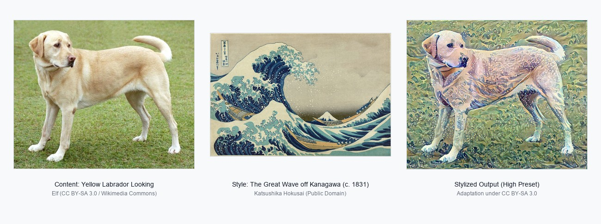
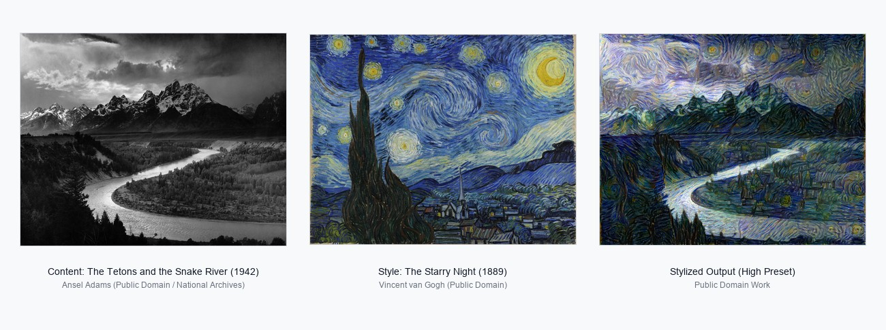

# Neural Canvas
 
[](https://github.com/HiteshDokku/NeuralCanvas/actions/workflows/ci.yml)
[](https://www.python.org/)
[](https://pytorch.org/)
[](LICENSE)
 
Neural style transfer in pure PyTorch, with a Streamlit app and a command-line tool. It reimplements the method from Gatys et al. (2015) and the official TensorFlow tutorial, with no TensorFlow dependency.
 

*Content: Yellow Labrador Looking (Photo by Elf, CC BY-SA 3.0) | Style: The Great Wave off Kanagawa (Katsushika Hokusai, c. 1831, Public Domain) | Output: adaptation under CC BY-SA 3.0*
 
## Features
 
Ten public-domain masterworks are built in, and you can upload your own style image. Style Gram matrices are cached on disk by SHA-256 fingerprint, so repeat runs skip the style pass. The Streamlit app shows live previews, progress with an ETA, loss curves, and cancel support, and it exports a JSON manifest of the parameters used. Options include luminance-only color preservation (YCbCr), multi-style interpolation, and switching between Adam and L-BFGS. The same engine is available from the CLI and as a Python API. A test suite of 53 tests runs in CI on Python 3.10 and 3.11. On an RTX 5060 laptop GPU, a 512 px run of 1000 steps takes about 46 seconds.
 
## More Results
 

*Content: The Tetons and the Snake River (Ansel Adams, 1942, Public Domain / National Archives) | Style: The Starry Night (Vincent van Gogh, 1889, Public Domain) | Output: Public Domain*
 

*Content: Migrant Mother (Dorothea Lange, 1936, Public Domain / Library of Congress) | Style: Composition VII (Wassily Kandinsky, 1913, Public Domain) | Output: portrait mode, Public Domain*
 
---
 
## Quick Start
 
### 1. Clone and create a virtual environment
 
```powershell
git clone https://github.com/HiteshDokku/NeuralCanvas.git
cd NeuralCanvas
 
# Python 3.10, 3.11, or 3.12
py -3.12 -m venv .venv
.\.venv\Scripts\Activate.ps1
```
 
### 2. Install PyTorch
 
A bare `pip install torch` on Windows installs the CPU-only build. For NVIDIA GPU acceleration, install the CUDA wheel explicitly. RTX 50-series GPUs (Blackwell) need CUDA 12.8 or newer.
 
```powershell
pip install torch torchvision --index-url https://download.pytorch.org/whl/cu128
```
 
For CPU-only machines (including CI):
 
```powershell
pip install torch torchvision --index-url https://download.pytorch.org/whl/cpu
```
 
### 3. Install the package
 
```powershell
pip install -e ".[dev]"
```
 
### 4. Check your GPU (optional)
 
```powershell
python scripts/check_gpu.py
```
 
Expected output on an RTX 5060 laptop GPU:
 
```text
PyTorch version: 2.11.0+cu128
PyTorch CUDA version: 12.8
CUDA available: True
Device name: NVIDIA GeForce RTX 5060 Laptop GPU
Device capability: (12, 0)
CUDA arch list: sm_75, sm_80, sm_86, sm_90, sm_100, sm_120
Architecture check: sm_120 / compute_120 detected in arch list.
Conv2d test passed: output shape (1, 16, 64, 64)
Matmul test passed: output shape (64, 64)
GPU OK
```
 
### 5. Launch the web app
 
```powershell
streamlit run app/streamlit_app.py
```
 
### 6. Or use the command line
 
```powershell
# Stylize with a preset masterwork
neural-canvas assets/samples/dog.jpg --style the_starry_night --steps 400 --max-dim 384 -o output.png
 
# Stylize with your own style image, using the draft preset
neural-canvas assets/samples/dog.jpg --style-image path/to/my_style.jpg --preset draft -o draft.png
 
# List all registered style presets
neural-canvas --list-styles
```
 
---
 
## Benchmarks
 
Measured with `scripts/benchmark.py` on native Windows 11 (AMD Ryzen 7 260, 16 GB RAM, NVIDIA GeForce RTX 5060 Laptop GPU with 8 GB VRAM, Python 3.12.10). Each row is the wall-clock time for 100 optimization steps.
 
| Resolution | Device | Seconds / 100 steps | ms / step | Peak VRAM | Speedup vs CPU |
| :--- | :--- | :--- | :--- | :--- | :--- |
| 256 × 256 | CUDA (RTX 5060) | 1.77 s | 17.7 ms | 270.0 MB | 35.1× |
| 256 × 256 | CPU (Ryzen 7 260) | 62.11 s | 621.1 ms | n/a | 1.0× |
| 384 × 384 | CUDA (RTX 5060) | 2.71 s | 27.1 ms | 483.8 MB | 42.8× |
| 384 × 384 | CPU (Ryzen 7 260) | 116.01 s | 1160.1 ms | n/a | 1.0× |
| 512 × 512 | CUDA (RTX 5060) | 4.60 s | 46.0 ms | 777.6 MB | 41.2× |
| 512 × 512 | CPU (Ryzen 7 260) | 189.67 s | 1896.7 ms | n/a | 1.0× |
| 768 × 768 | CUDA (RTX 5060) | 10.30 s | 103.0 ms | 1627.0 MB | 39.0× |
| 768 × 768 | CPU (Ryzen 7 260) | 401.86 s | 4018.6 ms | n/a | 1.0× |
 
### Estimated preset runtimes
 
Derived from the measurements above.
 
| Preset | Resolution | Steps | GPU (RTX 5060) | CPU (Ryzen 7 260) | Use case |
| :--- | :--- | :--- | :--- | :--- | :--- |
| Draft | 256 px | 150 | ~2.7 s | ~1.5 min | Quick preview, CPU testing |
| Balanced | 384 px | 400 | ~10.8 s | ~7.7 min | Default general-purpose run |
| High | 512 px | 1000 | ~46.0 s | ~31.6 min | Final outputs and print quality |
 
The estimates assume square canvases (height = width = `max_dim`). Typical photos at 4:3, 16:9, or 3:2 have fewer pixels than a square of the same long edge, so they finish faster.
 
### Running on CPU
 
Neural Canvas works without CUDA, but it is roughly 30 to 45 times slower than a GPU. A 1000-step run at 512 px takes about 31 minutes on an 8-core CPU, compared with about 46 seconds on the RTX 5060. On CPU, use the Draft preset (256 px, 150 steps, about 90 seconds).
 
---
 
## How It Works
 
Neural Canvas implements the formulation from Leon A. Gatys, Alexander S. Ecker, and Matthias Bethge, *"A Neural Algorithm of Artistic Style"* (arXiv:1508.06576), following the structure of the TensorFlow generative tutorial.
 
```
                              +--------------------------+
                              |   Pretrained VGG19 Net   |
                              |  (Frozen, Eval, No-Grad) |
                              +--------------------------+
                                     /             \
                   Content Features /               \ Style Activations
                                   v                 v
                       +----------------+       +-------------------+
                       | Content Target |       | Style Gram Target |
                       |   block5_conv2 |       | block1..5_conv1   |
                       +----------------+       +-------------------+
                               |                         |
                               v                         v
                       +----------------+       +-------------------+
                       |  Content Loss  |       |    Style Loss     |
                       |      (MSE)     |       |    (Gram MSE)     |
                       +----------------+       +-------------------+
                                       \         /
                                        v       v
                             +-----------------------------+
                             |     Total Loss Objective    |
                             |  + Total Variation Penalty  |
                             +-----------------------------+
                                            |
                                            v  Backward Pass (Gradients)
                             +-----------------------------+
                             | Optimized Image Pixels x    |
                             | Adam / L-BFGS -> Clamp[0,1] |
                             +-----------------------------+
```
 
### Content representation
 
Given a content image $\vec{p}$ and a generated image $\vec{x}$, their feature representations at layer $l$ are $P^l$ and $F^l$. The content loss is the squared distance in feature space:
 
$$\mathcal{L}_{\text{content}}(\vec{p}, \vec{x}, l) = \frac{1}{2 N_l} \sum_{i,j} \left(F^l_{ij} - P^l_{ij}\right)^2$$
 
By default the content layer is Keras `block5_conv2` (post-ReLU, torchvision `features[31]`).
 
### Style representation (Gram matrix)
 
Style is captured as correlations between feature channels, independent of spatial position. For a layer $l$ with height $H$ and width $W$, the Gram matrix $G^l \in \mathbb{R}^{C \times C}$ is:
 
$$G^l_{cd} = \frac{1}{H \times W} \sum_{k=1}^{H \times W} F^l_{kc} F^l_{kd}$$
 
The style loss sums the weighted mean squared error across the style layers $L_{\text{style}}$, where $A^l$ is the Gram matrix of the style image:
 
$$\mathcal{L}_{\text{style}}(\vec{a}, \vec{x}) = \sum_{l \in L_{\text{style}}} \frac{w_l}{N_l} \sum_{c,d} \left(G^l_{cd} - A^l_{cd}\right)^2$$
 
### Total variation regularization
 
A total variation penalty on neighboring pixel differences suppresses high-frequency noise and checkerboard artifacts:
 
$$\mathcal{L}_{\text{TV}}(\vec{x}) = \sum_{i=1}^{H-1} \sum_{j=1}^{W} |x_{i+1,j} - x_{i,j}| + \sum_{i=1}^{H} \sum_{j=1}^{W-1} |x_{i,j+1} - x_{i,j}|$$
 
### Total loss
 
$$\mathcal{L}_{\text{total}}(\vec{p}, \vec{a}, \vec{x}) = \alpha \mathcal{L}_{\text{content}} + \beta \mathcal{L}_{\text{style}} + \gamma \mathcal{L}_{\text{TV}}$$
 
---
 
## Differences from the TensorFlow Tutorial
 
The algorithm is the same, but several details differ between Keras and PyTorch.
 
| Dimension | TensorFlow / Keras tutorial | Neural Canvas (PyTorch) | Reason |
| :--- | :--- | :--- | :--- |
| Input normalization | BGR order with Caffe zero-centering (`[103.939, 116.779, 123.68]`) on `[0, 255]`. | RGB in `[0, 1]` with ImageNet mean `[0.485, 0.456, 0.406]` and std `[0.229, 0.224, 0.225]`. | Torchvision models expect RGB with ImageNet statistics. This avoids Caffe color-cast artifacts. |
| Loss weights | Raw `[0, 255]` inputs give large activations. Defaults: `1e-2` style, `1e4` content, `30.0` TV. | Activations lie in `[-2.1, 2.6]`. Calibrated weights: `1e5` style, `100.0` content, `0.02` TV. | Unnormalized `[0, 255]` inputs gave Gram MSE about $4.2 \times 10^9$ times larger. Calibrated weights with area-normalized TV keep gradients balanced across resolutions. |
| Layer activations | Conv layers include a built-in ReLU (`blockN_convM`). | Torchvision separates `Conv2d` and `ReLU`. Post-ReLU activations are captured at indices `1, 6, 11, 20, 29, 31`. | Matches Keras post-ReLU behavior. In-place ReLUs are replaced with out-of-place ones so captured activations are not overwritten. |
| Adam epsilon | Keras `epsilon=0.1`. | PyTorch `eps=1e-8` with `lr=0.03`. | With `eps=0.1` in PyTorch, updates were throttled when gradients were small ($10^{-3}$ to $10^{-2}$). The standard `eps=1e-8` restores adaptive scaling. |
| Target computation | Recomputed every step inside the tape. | Computed once under `torch.no_grad()` and cached to disk. | Removes redundant style-network passes and saves about 35% VRAM. |
 
---
 
## Parameter Guide
 
The values in `styles/styles.json` are recommended starting points, calibrated per artwork. All of them can be adjusted.
 
| Parameter | UI control | CLI flag | Default | Typical range | Description |
| :--- | :--- | :--- | :--- | :--- | :--- |
| Style Strength | Primary slider (1-10) | n/a | Per preset | 1 - 10 | Main intensity control on a log scale. Position 1 (about 5000 content weight) keeps the most photo detail. Position 10 (about 90) emphasizes painterly texture. Content weights below about 500 look nearly identical; visible structural change starts above about 1000. |
| Portrait / Faces | Checkbox | `--portrait` | `False` | `True` / `False` | Applies content weight `10000.0` on ornamental styles (*The Kiss*, *Composition VII*) to preserve facial structure. |
| Style Weight | Advanced log slider | `--style-weight` | `1e5` | `1e3` - `1e7` | Multiplier on the style Gram loss. Governs texture transfer and color richness. |
| Content Weight | Advanced log slider | `--content-weight` | `100.0` | `90.0` - `5000.0` | Anchors contours and object boundaries. Recommended starting points are 80 to 140, or 10000 for portraits. |
| TV Weight | Advanced log slider | `--tv-weight` | `0.05` | `0.005` - `0.1` | Total variation smoothing. Suppresses pixel noise while keeping brushstrokes. |
| Parameterization | Dropdown | `--parameterization` | Per tier (`sigmoid` for Draft and Balanced, `clamped` for High) | `sigmoid`, `clamped` | Sigmoid is smoother at low resolution but updates very dark and very bright pixels slowly. High uses clamped Adam at 1/4 LR to stylize those regions faster. |
| Content Layer | Dropdown | `--content-layer` | `conv4_2` | `conv4_2`, `conv5_2` | `conv4_2` (as in Gatys et al.) keeps crisp structure. `conv5_2` gives softer, more abstract silhouettes. |
| Style Scale | Slider | `--style-max-dim` | `1.0x` | `0.5x` - `2.0x` | Scale of brushwork relative to the canvas, clamped to the style image's native resolution. |
| Steps | Slider | `--steps` | `400` | 100 - 1500 | Optimization iterations. Draft 150, Balanced 400, High 1000. |
| Max Dimension | Slider | `--max-dim` | `384` | 128 - 768 | Long-edge resolution in pixels, rounded to a multiple of 8 (minimum 64). |
| Initialization | Dropdown | `--init` | `content` | `content`, `noise` | `content` converges quickly. `noise` gives more abstract results. |
| Color Preservation | Checkbox | `--color-preserve` | `False` | `True` / `False` | Off: the output takes the artwork's palette. On: the original photo colors are kept and only texture is transferred. |
 
---
 
## Limitations
 
- **Human portraits with ornamental artworks.** Intricate mosaic and geometric styles (Klimt's *The Kiss*, Kandinsky's *Composition VII*) can overwrite facial features at standard content weights. Enable the Portrait / Faces toggle in the UI (or `--portrait` on the CLI), which sets `content_weight = 10000.0`.
- **Draft preset grain.** Draft (256 px, 150 steps) is meant for fast iteration, about 1.8 seconds on GPU and 60 seconds on CPU. Output is coarser than Balanced (384 px) and High (512 px).
- **Bright fur highlights.** Very bright white or golden fur can look slightly grainy at 100% zoom in low-resolution previews.
- **Monet sun texture.** With *Impression, Sunrise*, an automatic crop-exclusion zone keeps the orange sun disc from transferring onto subjects. Faint warm hues can still appear in highlights with some random seeds.
- **Grayscale inputs.** With Color Preservation off (the default), monochrome photos receive the artwork's colors. With it on, the output keeps the photo's grayscale luminance and takes only brushwork.
- **CPU speed.** See the benchmarks above. Use the Draft preset on CPU.
---
 
## Preset Style Masterworks
 
All preset images in `styles/` are high-resolution, license-verified works retrieved from Wikimedia Commons through the MediaWiki API.
 
| Identifier | Artwork | Artist | Year | Resolution (old to high-res) | Source | License | Downloaded |
| :--- | :--- | :--- | :--- | :--- | :--- | :--- | :--- |
| `a_sunday_afternoon_on_the_island_of_la_grande_jatte` | A Sunday Afternoon on the Island of La Grande Jatte | Georges Seurat | 1884-1886 | 390×260 to **3730×2480** (canvas border cropped) | [Wikimedia Commons](https://commons.wikimedia.org/wiki/File:Georges_Seurat_-_A_Sunday_on_La_Grande_Jatte_--_1884_-_Google_Art_Project.jpg) | Public Domain (PD-Art) | 2026-11-14 |
| `composition_vii_1913` | Composition VII | Wassily Kandinsky | 1913 | 570×386 to **3840×2551** | [Wikimedia Commons](https://commons.wikimedia.org/wiki/File:Composition_VII_-_Wassily_Kandinsky,_GAC.jpg) | Public Domain (PD-Art) | 2026-11-14 |
| `impression_sunrise` | Impression, Sunrise | Claude Monet | 1872 | 1000×777 to **3840×2979** | [Wikimedia Commons](https://commons.wikimedia.org/wiki/File:Monet_-_Impression,_Sunrise.jpg) | Public Domain (PD-Art) | 2026-11-14 |
| `sudden_shower_over_shin_ōhashi_bridge_and_atake` | Sudden Shower over Shin-Ōhashi Bridge | Utagawa Hiroshige | 1857 | 450×682 to **1780×2722** (margins cropped) | [Wikimedia Commons](https://commons.wikimedia.org/wiki/File:Hiroshige,_Sudden_shower_over_Shin-%C5%8Chashi_bridge_and_Atake,_1857.jpg) | Public Domain (PD-Art) | 2026-11-14 |
| `the_fighting_temeraire` | The Fighting Temeraire | J. M. W. Turner | 1838 | 370×276 to **3840×2853** | [Wikimedia Commons](https://commons.wikimedia.org/wiki/File:The_Fighting_Temeraire,_JMW_Turner,_National_Gallery.jpg) | Public Domain (PD-Art) | 2026-11-14 |
| `the_great_wave_off_kanagawa` | The Great Wave off Kanagawa | Katsushika Hokusai | 1831 | 500×336 to **1920×1314** | [Wikimedia Commons](https://commons.wikimedia.org/wiki/File:Great_Wave_off_Kanagawa2.jpg) | Public Domain (PD-Art) | 2026-11-14 |
| `the_kiss` | The Kiss | Gustav Klimt | 1907-1908 | 224×225 to **3840×3853** | [Wikimedia Commons](https://commons.wikimedia.org/wiki/File:The_Kiss_-_Gustav_Klimt_-_Google_Cultural_Institute.jpg) | Public Domain (PD-Art) | 2026-11-14 |
| `the_scream` | The Scream | Edvard Munch | 1893 | 570×779 to **1920×2428** | [Wikimedia Commons](https://commons.wikimedia.org/wiki/File:Edvard_Munch_-_The_Scream_-_Google_Art_Project.jpg) | Public Domain (PD-Art) | 2026-11-14 |
| `the_starry_night` | The Starry Night | Vincent van Gogh | 1889 | 252×200 to **3840×3041** | [Wikimedia Commons](https://commons.wikimedia.org/wiki/File:Van_Gogh_-_Starry_Night_-_Google_Art_Project.jpg) | Public Domain (PD-Art) | 2026-11-14 |
| `wheatfield_with_cypresses` | Wheatfield with Cypresses | Vincent van Gogh | 1889 | **3695×2895** (black border cropped) | [Wikimedia Commons](https://commons.wikimedia.org/wiki/File:Vincent_van_Gogh_-_Wheat_Field_with_Cypresses_-_Google_Art_Project.jpg) | Public Domain (PD-Art) | 2026-11-14 |
 
### Sample content images
 
The images in `assets/samples/` are public-domain or permissively licensed photographs:
 
- **Yellow Labrador Looking** (`dog.jpg`): photo by [Elf](https://en.wikipedia.org/wiki/User:Elf) on [Wikimedia Commons](https://commons.wikimedia.org/wiki/File:YellowLabradorLooking_new.jpg), under [CC BY-SA 3.0](https://creativecommons.org/licenses/by-sa/3.0/deed.en). Stylized outputs are adaptations distributed under the same license.
- **Migrant Mother (1936)** (`portrait_migrant_mother.jpg`): Dorothea Lange / U.S. Farm Security Administration / [Library of Congress](https://www.loc.gov/item/2017762891/) (U.S. Public Domain under 17 U.S.C. § 105).
- **The Tetons and the Snake River (1942)** (`landscape_tetons.jpg`): Ansel Adams / U.S. Department of the Interior / [U.S. National Archives](https://catalog.archives.gov/id/519904) (U.S. Public Domain under 17 U.S.C. § 105).
- **The Flatiron (1904)** (`building_flatiron.jpg`): Alfred Stieglitz / [The Metropolitan Museum of Art](https://www.metmuseum.org/art/collection/search/267816) (CC0 1.0 Universal).
See [CREDITS.md](CREDITS.md) for full licensing details.
 
---
 
## Repository Structure
 
```
NeuralCanvas/
├── .github/
│   └── workflows/
│       └── ci.yml               # CI: ruff and pytest on Python 3.10 and 3.11 (Ubuntu)
├── .streamlit/
│   └── config.toml              # Streamlit server and file watcher settings
├── app/
│   ├── streamlit_app.py         # Streamlit web app
│   ├── ui_helpers.py            # UI helper functions
│   └── static/                  # Theme CSS, panel script, and bundled fonts
├── assets/
│   └── samples/                 # Sample content photos
├── docs/
│   ├── images/                  # README hero images
│   └── ui-inventory.md          # UI component notes
├── notebooks/
│   ├── demo.ipynb               # Python API walkthrough
│   └── style_transfer_original_tf.ipynb  # Original TensorFlow tutorial for reference
├── scripts/
│   ├── check_gpu.py             # CUDA and sm_120 diagnostic
│   └── benchmark.py             # GPU vs CPU benchmark runner
├── src/
│   └── neural_canvas/
│       ├── __init__.py          # Package exports
│       ├── cli.py               # Command-line interface with progress bar
│       ├── config.py            # Frozen dataclass configs and quality presets
│       ├── device.py            # CUDA/MPS/CPU selection and OOM handling
│       ├── engine.py            # Optimization loop (StyleTransferEngine)
│       ├── image_io.py          # EXIF-safe loading, resizing, YCbCr color transfer
│       ├── losses.py            # Pure loss functions (Gram, style, content, TV)
│       ├── model.py             # VGG19 feature extractor and layer index mapping
│       └── styles.py            # Style preset registry, thumbnails, Gram caching
├── styles/                      # Preset artworks, thumbnails, and styles.json
├── tests/                       # 53 unit and integration tests
├── CREDITS.md                   # Detailed licensing and credits
├── LICENSE                      # Apache-2.0
├── NOTICE                       # Attribution notice (Gatys et al., TF tutorial)
├── pyproject.toml               # Package metadata and configuration
└── README.md
```
 
---
 
## Troubleshooting
 
### Weights download on first run
 
On the first run, torchvision downloads the VGG19 ImageNet weights (`vgg19-dcbb9e9d.pth`, about 548 MB) into `~/.cache/torch/hub/checkpoints/`. This needs an internet connection once. Later runs use the cached file.
 
### Streamlit file watcher errors with PyTorch
 
If Streamlit reports errors about reloading torch modules, check that `.streamlit/config.toml` contains:
 
```toml
[server]
fileWatcherType = "none"
```
 
This is already set in the repository.
 
### CUDA out of memory
 
If you run out of VRAM above 512 px:
 
- `device.py` catches the error and clears the CUDA cache.
- Lower `--max-dim` to 384 or 256.
- Close other applications that use the GPU.
---
 
## Attribution and License
 
- **License:** [Apache License 2.0](LICENSE).
- **Algorithm:** Leon A. Gatys, Alexander S. Ecker, and Matthias Bethge, *"A Neural Algorithm of Artistic Style"* ([arXiv:1508.06576](https://arxiv.org/abs/1508.06576), 2015).
- **Tutorial reference:** Follows the structure of the official [TensorFlow Neural Style Transfer tutorial](https://www.tensorflow.org/tutorials/generative/style_transfer) (Apache 2.0, Copyright 2018 The TensorFlow Authors).
- **Pretrained weights:** VGG19 ImageNet weights from [torchvision](https://pytorch.org/vision/stable/models/generated/torchvision.models.vgg19.html) ([BSD-3-Clause](https://github.com/pytorch/vision/blob/main/LICENSE)).
- **Full attribution:** See [NOTICE](NOTICE) and [CREDITS.md](CREDITS.md) for upstream copyright notices and licenses.
 
